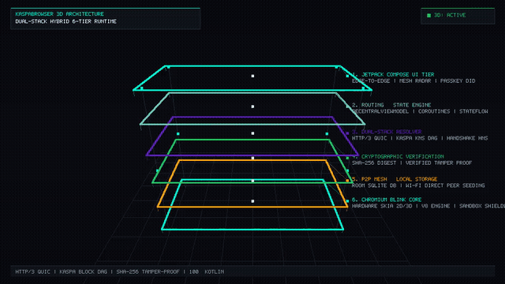

<p align="center">
  
</p>

<h1 align="center">Kaspa Browser</h1>

<p align="center">
  <i>Security-First Android Browser &amp; Web3 Gateway Powered by Kazview</i>
</p>

<p align="center">
  
  
  
  
  
  
  
</p>

**Kaspa Browser** is an Android web browser and Web3 gateway built with **Kotlin** and **Jetpack Compose (Material 3)**. It pairs **Kazview** (its hybrid Chromium/Android System WebView + Jetpack WebKit + Custom Tabs orchestration core) with a hardware-backed Password & Passkey Vault, fail-closed encrypted DNS-over-HTTPS (DoH), real-time tracker/ad shielding, decentralized name resolution, an encrypted Kaspa wallet & dApp bridge, signal-only ecosystem notifications, and optional native Rust crates (`kaspasearch-engine`, `kaspasearch-core`).

---

## System Architecture & Visual Overview

<p align="center">
  <a href="architecture_3d_overview.gif" title="KaspaBrowser Architecture Overview">
    
  </a>
</p>

<p align="center">
  <a href="architecture_diagram.jpg">
    
  </a>
  &nbsp;
  <a href="brand_palette.jpg">
    
  </a>
</p>

---

## Why Kaspa Browser Is Different

Mainstream mobile browsers prioritize ad-tech telemetry, cloud account lock-in, or thin single-process WebView wrappers. **Kaspa Browser** is engineered differently from the ground up:

1. **Security-First Defaults Without Telemetry**:
   - Credentials live in an on-device **Android Keystore AES-256-GCM** Room vault gated by biometrics/device lock and automatically locked whenever the app leaves the foreground (`MainActivity.onStop`).
   - Autofill uses a main-frame-only, origin-and-host-verified `WebMessageListener` bridge (`PasswordAutofillBridge`) instead of exposing password-manager `@JavascriptInterface` objects to untrusted page scripts, and explicitly skips third-party CAPTCHA and payment frames.
   - All tabs, preview WebViews, and ServiceWorkers enforce strict sandboxing (`allowFileAccess = false`, `allowContentAccess = false`, `MIXED_CONTENT_NEVER_ALLOW`, SSL cancel-on-error, Google Safe Browsing, and `http`/`https`-only external intent checks).
2. **Kazview Hybrid Architecture (Full Web Compatibility + Custom Control)**:
   - Instead of maintaining a fragile forked browser binary or leaving stock WebView unoptimized, **Kazview** layers asynchronous renderer warmup, QUIC profile hints, Blink Back/Forward Cache, Privacy Sandbox Attribution suppression, multi-profile Stealth isolation, bounded tab hibernation, and Custom Tabs WebAuthn handoff directly over Android System WebView + Jetpack WebKit.
3. **Truthful Networking & Fail-Closed Encrypted DNS**:
   - DNS resolution goes through pinned **Encrypted DoH** (`cloudflare-dns.com`, `dns.quad9.net`, `dns.google`) with unencrypted system DNS fallback disabled.
   - All blocked/allowed requests are visible live in **Traffic Audit**, and local loopback privacy daemons (`KrpRelayDaemon`, `LightweightTorEngine`) explicitly document their guarantees without overclaiming external IP masking unless an upstream SOCKS5/HTTP proxy (such as Orbot) is configured.
4. **Native Web3, Kaspa & Mesh Capabilities Built Into the Browser**:
   - Ships first-class `.kas`, `.hns`, `.eth`, and `ipfs://` resolution (`DualStackResolver`), an on-device HD/Testnet wallet & transaction confirmation sheet, KRC-20 / KCC-20 protocol support, a secp256k1 Schnorr Sigma Zero-Knowledge Proof utility (`ZkProofEngine`), and live LAN/NSD + Bluetooth **Mesh Radar**.
5. **Zero-Spam, Zero-Duplicate Ecosystem Notifications**:
   - General Kaspa news article notifications and the legacy `"All Kaspa Articles"` channel have been removed. Users only receive high-signal **Breaking Kaspa News** and **Kaspa Ecosystem Developments** alerts, deduplicated across feeds, URL tracking parameters, and in-app refreshes.

---

## Kazview: Browser Core Architecture

**Kazview** (`com.example.engine.BrowserEngineManager`, `com.example.util.KaspaWebViewConfigurator`, `com.example.util.BrowserTabWebViewManager`) is Kaspa Browser's browser core coordinator.

### How Kazview Works

| Layer | Implementation in Kazview | Purpose |
|---|---|---|
| **Rendering Foundation** | Android System WebView (Chromium/Blink) + `androidx.webkit:webkit` + `androidx.browser:browser` | Full HTML5, CSS, WebAssembly, ServiceWorker, and modern web app compatibility with OS security patches. |
| **Async Off-UI Startup** | `WebViewCompat.startUpWebView` (`WebViewStartUpConfig`) + `warmUpRendererProcess()` | Initializes Chromium off the main thread at launch and reports startup duration & UI blocking telemetry. |
| **QUIC & Speculative Preconnect** | `ADD_QUIC_HINTS_V1` + privacy-gated `ENQUEUE_PRECONNECT` / `PRECONNECT` | Pre-warms HTTP/3 QUIC hints (`kaspa.org`, `explorer.kaspa.org`, `api.kaspa.org`, `api.kasplex.org`, `github.com`, `wikipedia.org`) and preconnects HTTPS origins with a 60s cooldown—automatically bypassed when privacy relay mode is active or URLs are trackers/auth challenges. |
| **Blink Privacy & Speed Tuning** | `BACK_FORWARD_CACHE` + `ATTRIBUTION_REGISTRATION_BEHAVIOR (DISABLED)` | Enables instant Back/Forward page restoration while disabling Privacy Sandbox ad attribution tracking. |
| **Document-Start Shielding** | `DOCUMENT_START_SCRIPT` (`KaspaPrivacyEngine.JS_PRIVACY_SHIELD_INJECTION` + `BrowserBackgroundPlayback`) | Injects privacy protections and media session hooks before page scripts execute, plus `ServiceWorkerController` ad/tracker filtering that preserves PWA assets. |
| **Multi-Profile Stealth Isolation** | `WebViewFeature.MULTI_PROFILE` (`kazview_stealth`) | Isolates Stealth/Incognito tabs into a dedicated Chromium cookie & storage profile (`clearStealthProfile()` wipes it cleanly) while keeping standard tabs intact. |
| **Tab Freezing & Memory Guard** | `pauseTab` / `resumeTab` + `hibernateColdTabsIfNeeded` + `saveWebViewStateBounded` (512 KB cap) | Freezes background tabs with `onPause()` and hibernates oldest inactive tabs when live WebViews exceed 6, capturing bounded state, scroll position, and history without risking `TransactionTooLargeException`. |
| **Passkey & Custom Tab Handoff** | `WEB_AUTHENTICATION_SUPPORT_FOR_BROWSER` + `openInCustomTab` | Enables WebAuthn passkeys inside tabs when permitted by system WebView policy and provides one-tap Android Custom Tabs handoff for sites requiring privileged Digital Asset Links. |

---

## Browser Components & Features

### 1. Core Browser Workspace & UX (`ui/`, `util/`, `omnibar/`)
- **Browser Gateway & Home (`BrowserGatewayScreen.kt`, `BrowserHomeScreen.kt`, `MainScreen.kt`, `NestedWebView.kt`)**:
  - Multi-tab manager supporting standard and Stealth tabs, nested-scroll pull-to-refresh top-boundary guards, and live link preview modals (`WebsiteLivePreviewModal.kt`).
  - One-tap **Desktop / Mobile Mode** toggle switching User-Agent strings, `useWideViewPort`, `loadWithOverviewMode`, and `980px` desktop layout viewports while resetting initial scale cleanly.
- **Smart Omnibox & Instant Hub Cards (`SmartOmniboxOverlay.kt`, `SmartOmnibarCards.kt`, `SmartOmnibarEngine.kt`, `ui/components/`)**:
  - Evaluates navigation intent directly in the address bar with rich cards: **Math Solver**, **Color Preview**, **Live Kaspa Price Hub**, **Buy Kaspa Hub**, **KRC-20 Token cards**, and **Webpage Preview**.
- **Page Translator Bar (`PageTranslatorBar.kt`)**:
  - Floating 20-language page translation bar (`en`, `es`, `fr`, `de`, `zh-CN`, `ja`, `ru`, `pt`, `ar`, `hi`, `ko`, `it`, `tr`, `nl`, `pl`, `id`, `vi`, `uk`, `th`, `el`) with instant revert and web gateway translation fallback.
- **Distraction-Free Reader Mode (`KaspaReaderMode.kt`)**:
  - Extracts clean article title, byline, lead image, word count, reading time, and video embeds (uses native JNI `libkaspasearch.so` if present, with full pure-Kotlin extraction fallback).
- **Background Media Playback (`BrowserBackgroundPlayback.kt`, `BrowserMediaPlaybackService.kt`)**:
  - Foreground notification media service (`NOTIFICATION_ID = 7301`, `browser_media_playback` channel) polling page playback metadata so audio/video continues with lock-screen and notification controls.
- **PWA Standalone Mode (`PwaStandaloneActivity.kt`, `PwaShortcutHelper.kt`, `PwaInstallDialog.kt`)**:
  - Installs web apps as home-screen shortcuts and launches them in a dedicated standalone activity wired into the autofill bridge.
- **[NEW] Storage & Cache Diagnostics (`BrowserStorageDiagnosticsCard.kt`)**:
  - Breaks down **App Cache**, **WebView Cache**, **Room Databases**, and **Site WebStorage / Origin Counts** separately so clearing cache never unexpectedly wipes saved logins, bookmarks, tabs, or history.

### 2. Security, Password & Passkey Vault (`security/`, `ui/`, `MainActivity.kt`) **[Updated]**
- **Encrypted Credential Vault (`PasswordVaultRepository.kt`, `PasswordVaultDialog.kt`, `PasswordGenerator.kt`, `BiometricAuthHelper.kt`)**:
  - Stores logins and passkey metadata in Room encrypted with **Android Keystore AES-256-GCM** (`CryptoUtils`), unlocked via biometrics/PIN and auto-locked on app backgrounding (`MainActivity.onStop`). Includes a CSPRNG password generator.
- **Origin-Verified Autofill Bridge (`PasswordAutofillBridge.kt`, `KaspaWebAuthnBridge.kt`)**:
  - Uses `WebViewCompat.addWebMessageListener` with strict main-frame checks, origin validation, and host matching (`isHostMatch`) before injecting saved credentials; blocks CAPTCHA/payment origins (`challenges.cloudflare.com`, `hcaptcha.com`, `recaptcha.net`, `arkoselabs.com`, `stripe.com`, `paypal.com`).
- **[NEW] Full-Page Passkey & Kazview Diagnostics (`WebAuthnDiagnosticsDialog` in `BrowserAutofillAndPasskeyUi.kt`)**:
  - Full-screen diagnostic view (sized safely inside `WindowInsets.safeDrawing` so no action bar is clipped beneath device edges) displaying:
    - Live **Kazview** & System WebView package/version, multi-process isolation status, async startup metrics, QUIC hints, BFCache, and active `MULTI_PROFILE` state.
    - Active WebAuthn policy mode (`FOR_BROWSER Active` vs `Restricted by System Policy`) with clear explanation and one-tap **Open in System Browser Custom Tab** handoff for strict FIDO2 Relying Parties.
- **WebView & Intent Hardening (`KaspaSecurityGuard.kt`, `PlayIntegrityManager.kt`)**:
  - `http://`/`https://`-only `Intent.ACTION_VIEW` validation, `FLAG_ACTIVITY_LAUNCHED_FROM_HISTORY` replay protection, scheme rejection for `file://`, `content://`, `javascript://`, and `data://`, plus Play Integrity helper integration.

### 3. Signal-Only Ecosystem Notifications (`news/KaspaNewsNotificationWorker.kt`, `data/NewsModels.kt`) **[New Fix]**
- **General Kaspa Articles Removed**:
  - Deleted the `"All Kaspa Articles"` (`kaspa_news_articles`) notification channel and removed the duplicate `DecentralViewModel` notification emitter (`kaspa_news_channel` / ID `1`). Legacy channels and notification IDs are automatically deleted/canceled on startup and sync.
- **High-Signal Categories Only**:
  - Background WorkManager sync (`kaspa_news_background_sync`) notifies **only** for:
    - **Breaking Kaspa News (`kaspa_breaking_news`)**: Urgent security alerts, consensus bugs, mainnet outages, zero-day/exploit notices.
    - **Kaspa Ecosystem Developments (`kaspa_ecosystem_news`)**: GitHub releases (`rusty-kaspa`, `kaspad`), GhostDAG/protocol upgrades, KRC-20/KRC-721/Kasplex launches, wallets, and exchange integrations.
- **Anti-Duplicate & Hygiene Safeguards**:
  - Ordered FIFO JSON seen-key persistence (up to 1,500 keys, migrating legacy unordered `StringSet` entries) guarded by coroutine `Mutex` + synchronization lock.
  - Dual-key deduplication matching **both** publisher-stripped normalized headlines and `EmbeddedRustSearchEngine.sanitizeUrl` canonical URLs (stripping `utm_*` tracking params, fragments, and trailing slashes).
  - Foreground-to-background synchronization (`markItemsSeen`) prevents articles fetched inside the app from triggering repeat background alerts.
  - Silent first-run baseline initialization, `MAX_NOTIFICATIONS_PER_RUN = 2` burst cap (prioritizing Breaking alerts), `POST_NOTIFICATIONS` runtime check (API 33+), `http`/`https` URI verification, `setOnlyAlertOnce(true)`, and non-colliding notification IDs (`>= 10_000`).

### 4. Networking, Privacy Shielding & Relay Transport (`network/`, `TrafficAuditScreen.kt`)
- **Cronet + OkHttp3 (`CronetClientFactory.kt`)**: Enables Chromium Cronet HTTP/3 (QUIC), HTTP/2, Brotli, AsyncDNS, and StaleDNS via `CronetInterceptor`.
- **Ad & Tracker Shielding (`KaspaPrivacyEngine.kt`, `UBlockEngine.kt`, `TrafficAuditScreen.kt`)**: Intercepts subresource and ServiceWorker tracker/ad requests while preserving stylesheets, scripts, fonts, OAuth, and challenge flows; logs real allowed/blocked traffic in **Traffic Audit**.
- **Fail-Closed Encrypted DoH (`KaspaPrivacyRelayEngine.kt`)**: Resolves hostnames via `cloudflare-dns.com`, `dns.quad9.net`, and `dns.google` using pinned bootstrap IPs with system DNS disabled on relay resolution.
- **Local Loopback Relay & SOCKS5 Forwarder (`KrpRelayDaemon.kt`, `LightweightTorEngine.kt`, `WebViewProxyManager.kt`)**:
  - `KrpRelayDaemon` binds localhost (`127.0.0.1`) Entry (`8443`) and Exit (`8444`) sockets implementing X25519 key exchange, HKDF-SHA256, ChaCha20-Poly1305, and 1024-byte cell framing.
  - `LightweightTorEngine` runs a localhost SOCKS5 listener (`9155`/`9156`) resolving domains through fail-closed Encrypted DoH and blocking recursive self-loops into local daemon ports.
  - **Transparency Note**: Running these loopback listeners in-process secures local loopback transport and forces encrypted DoH, **but does not change your public egress IP** unless a real external upstream SOCKS5/HTTP proxy (such as Orbot/Tor) is configured.

### 5. Web3, Kaspa Wallet, ZKP & Decentralized Discovery (`network/kaspa/`, `network/zk/`, `dapp/`, `ui/`)
- **Kaspa Wallet & dApp Bridge (`KaspaWalletService.kt`, `KaspaTransactionEngine.kt`, `KaspaTestnetWalletScreen.kt`, `DappsScreen.kt`, `DappPromptSheet.kt`, `TransactionConfirmationBottomSheet.kt`)**: On-device HD wallet & key management (`BouncyCastle`, `Web3j`), Kaspa testnet wallet interface, and explicit user-approved dApp signing sheets.
- **Token & Domain Protocols (`Krc20Service.kt`, `Kcc20Protocol.kt`, `KbKcc20*`, `DotkProtocol.kt`, `KaspaDomainRegistry.kt`, `DualStackResolver.kt`)**: Supports `.kas`, `.hns`, `.eth`, and `ipfs://` targets alongside SHA-256 content checks and KRC-20/KCC-20 tooling.
- **Zero-Knowledge Proofs (`ZkProofEngine.kt`)**: secp256k1 non-interactive Schnorr Sigma NIZKP (`Fiat-Shamir` transform) for proving public key knowledge without exposing private keys.
- **Mesh Radar & Local Node Manager (`MeshRadarScreen.kt`, `NetworkDiscoveryManager.kt`, `LocalNodeManager.kt`, `BluetoothMeshManager.kt`)**: Live LAN/NSD discovery and real TCP/HTTP reachability checks against configured node endpoints.

### 6. Research, Search & Optional Native/Desktop Workspaces (`network/siagent/`, `kaspasearch-*`, `desktop/`)
- **SI Agent (`SiAgentScreen.kt`, `AndroidWebResearch.kt`, `SiWebCrawler.kt`, `GroqKeyStore.kt`)**:
  - Local web crawling and research work entirely on-device without any API key.
  - Optional AI synthesis via Groq Chat Completions using each user's **own API key** (`gsk_...`), encrypted on-device in Android Keystore—never hardcoded or bundled.
- **Federated Search (`EmbeddedRustSearchEngine.kt`, `SearchResultsScreen.kt`, `kaspasearch-engine/`, `kaspasearch-core/`)**:
  - Strips tracking parameters (`utm_*`, `fbclid`, `gclid`, etc.) and aggregates search results. Uses native JNI (`libkaspasearch.so`) if compiled into `app/src/main/jniLibs`, and falls back automatically to a complete pure-Kotlin implementation when native binaries are absent.
- **Desktop Companion (`desktop/linux/cef/`)**: Linux CEF companion workspace files alongside the primary Android application.

---

## Connecting From Another Android App

External apps can open HTTPS/HTTP URLs in Kaspa Browser using standard `Intent.ACTION_VIEW`:

```kotlin
val intent = Intent(Intent.ACTION_VIEW, Uri.parse("https://example.com")).apply {
    setPackage(targetPackageName)
}
context.startActivity(intent)
```

Incoming intents enforce strict protocol checks (`http://` and `https://` only), history replay filtering (`FLAG_ACTIVITY_LAUNCHED_FROM_HISTORY`), scheme rejection for `file://`, `content://`, `javascript://`, and `data://`, and single-consumption of handled URL payloads.

---

## Natural Desktop / Mobile Mode

- One-tap **Desktop site** toggle in the browser menu backed by User-Agent switching, `useWideViewPort`, `loadWithOverviewMode`, and `980px` desktop layout viewport behavior.
- Cleanly resets initial scale (`setInitialScale(0)`) on mode changes while preserving multi-touch pinch-to-zoom and pull-to-refresh top-boundary guards (`NestedWebView.kt`).

---

## Project Structure

```
├── .github/workflows/                 # CI/CD workflows (Android build & test)
├── app/
│   ├── build.gradle.kts               # App module (compileSdk 36, targetSdk 36, minSdk 24)
│   ├── proguard-rules.pro             # R8/ProGuard keep rules
│   └── src/
│       ├── main/
│       │   ├── AndroidManifest.xml
│       │   └── java/com/example/
│       │       ├── MainActivity.kt               # Edge-to-Edge, intent validation, vault auto-lock
│       │       ├── dapp/                         # Web3 dApp prompt & sign request models
│       │       ├── data/                         # Room AppDatabase, DAOs, Entities & NewsModels
│       │       ├── engine/
│       │       │   └── BrowserEngineManager.kt   # Kazview coordinator: warmup, QUIC, profiles, Custom Tabs
│       │       ├── model/                        # Network, mesh, relay & traffic models
│       │       ├── network/                      # Cronet, DoH, KRP/1, SOCKS5 forwarder, adblock, wallet, ZK, SI Agent
│       │       ├── news/
│       │       │   └── KaspaNewsNotificationWorker.kt # Breaking/Ecosystem WorkManager alerts + dedup
│       │       ├── omnibar/                      # Smart Omnibar intent & entity helpers
│       │       ├── security/                     # AES-256-GCM vault, autofill bridge, CSPRNG, Play Integrity
│       │       ├── ui/                           # Compose screens (Browser, Vault, Passkey Diagnostics, Radar, Audit, SI)
│       │       ├── util/                         # KaspaWebViewConfigurator, tab hibernation & background media
│       │       ├── utils/                        # BiometricAuthHelper & helper utilities
│       │       └── viewmodel/
│       │           └── DecentralViewModel.kt     # Reactive UI & browser state management
│       └── test/java/com/example/                # JUnit & Robolectric verification tests
├── architecture_3d_overview.gif       # Animated architecture graphic
├── architecture_diagram.jpg           # System architecture diagram
├── brand_palette.jpg                  # Visual palette guide
├── desktop/linux/cef/                 # Desktop Linux CEF companion workspace files
├── gradle/libs.versions.toml          # Centralized Gradle Version Catalog
├── kaspasearch-core/                  # Shared Rust search core crate
├── kaspasearch-engine/                # Optional JNI Rust crate (libkaspasearch.so)
└── settings.gradle.kts
```

---

## Technology Stack

| Layer | Verified Dependencies & Tools |
|---|---|
| **Language** | Kotlin (JVM 17 bytecode target) &bull; Optional Rust 2021 crates (`kaspasearch-*`) |
| **UI Framework** | Jetpack Compose + Material 3 (`Edge-to-Edge`, `WindowInsets.safeDrawing`) |
| **Android SDK** | `compileSdk = 36`, `targetSdk = 36`, `minSdk = 24` |
| **Browser Core (Kazview)** | Android System WebView + `androidx.webkit:webkit` + `androidx.browser:browser` |
| **Networking** | `OkHttp3`, Google Play Services `Cronet` + `cronet-okhttp`, `Retrofit`, `Moshi` |
| **Security & Auth** | Android Keystore (`AES-256-GCM`), `androidx.biometric`, `androidx.credentials`, Google Play Integrity |
| **Local Storage & Work** | AndroidX `Room` + `KSP`, `androidx.work:work-runtime-ktx` |
| **Cryptography & Web3** | `Web3j` Android, `BouncyCastle` (`bcprov-jdk18on`), secp256k1 Schnorr Sigma NIZKP |
| **Parsing & Media** | `Jsoup`, `Coil` Compose, `ZXing`, `androidx.media` |
| **Testing** | JUnit4, `kotlinx-coroutines-test`, `Robolectric`, `Roborazzi`, Compose UI Test |

---

## Building & Testing

> Use system `gradle` directly if Gradle Wrapper scripts are not present in this environment.

Compile the debug APK:
```bash
gradle :app:assembleDebug
```

Build the release APK:
```bash
gradle :app:assembleRelease
```

Run the local JVM + Robolectric test suite:
```bash
gradle :app:testDebugUnitTest --console=plain
```

### Automated GitHub Release Workflow
Tagging a release triggers `.github/workflows/android_build.yml`:
- When release keystore secrets are provided (`KEYSTORE_PATH` / `STORE_PASSWORD` / `KEY_ALIAS` / `KEY_PASSWORD` via CI secrets), Gradle signs the release build.
- Otherwise, `app/build.gradle.kts` produces an unsigned release APK rather than falling back to insecure hardcoded credentials.

---

## License

Open source under the [Apache License 2.0](LICENSE).
